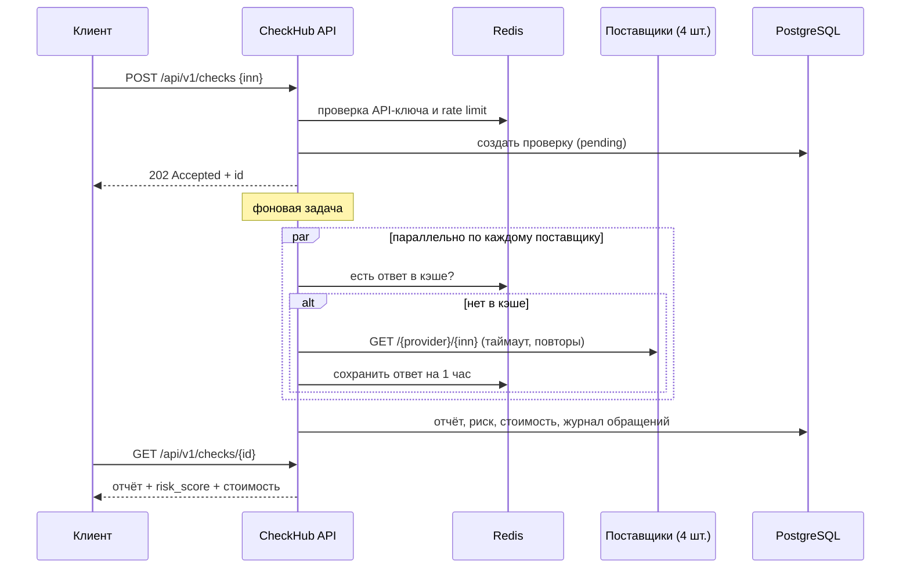

# CheckHub — проверка контрагентов по ИНН


REST API, которое по ИНН собирает **один отчёт из нескольких платных источников данных** (реестр юрлиц, арбитражные дела, банкротства, исполнительные производства), считает риск контрагента и показывает, сколько стоила проверка.

Задача взята из практики: в таких сервисах каждый запрос к поставщику стоит денег, поставщики периодически падают или тормозят, а пользователю нужен ответ, даже если один источник недоступен.

## Что внутри

- **FastAPI + Pydantic v2** — асинхронное API с валидацией ИНН по контрольной сумме (алгоритм ФНС).
- **PostgreSQL + SQLAlchemy 2.0 (async) + Alembic** — проверки и журнал обращений к поставщикам.
- **Redis** — кэш ответов поставщиков (повторная проверка того же ИНН бесплатна) и rate limit по API-ключу.
- **Параллельный опрос поставщиков** через `asyncio.gather`: время проверки ≈ время самого медленного источника.
- **Отказоустойчивость**: таймауты, повторы с экспоненциальной задержкой, circuit breaker, частичный отчёт, если источник недоступен.
- **Учёт стоимости**: цена каждого обращения хранится в копейках, `/stats` показывает расходы и долю попаданий в кэш по каждому поставщику.
- **Тесты** (pytest, 23 шт.) без внешних зависимостей: SQLite, fakeredis, поставщики через ASGI.
- **Docker Compose** и **GitHub Actions** (ruff + pytest).

## Как это работает



Чтобы проект работал «из коробки», внешние поставщики заменены встроенными заглушками (`/mock/...`): данные детерминированы по ИНН, а задержки и сбои случайны, как у настоящих API. Чтобы подключить реальных поставщиков, достаточно поменять `CHECKHUB_PROVIDERS_BASE_URL`.

## Запуск

```bash
docker compose up --build
```

Документация API: http://localhost:8000/docs

```bash
# Создать проверку
curl -X POST http://localhost:8000/api/v1/checks \
  -H "X-API-Key: dev-key" -H "Content-Type: application/json" \
  -d '{"inn": "7707083893"}'

# Получить результат
curl http://localhost:8000/api/v1/checks/<id> -H "X-API-Key: dev-key"

# Расходы и эффективность кэша
curl http://localhost:8000/api/v1/stats -H "X-API-Key: dev-key"
```

Пример ответа:

```json
{
  "inn": "7707083893",
  "status": "done",
  "risk_score": 25,
  "risk_level": "medium",
  "risk_factors": ["Ответчик по 7 арбитражным делам", "Исполнительных производств: 1"],
  "total_cost_rub": 7.5,
  "calls": [
    {"provider": "bankruptcy", "status": "ok", "attempts": 1, "duration_ms": 212, "cost_kop": 100},
    {"provider": "courts", "status": "ok", "attempts": 2, "duration_ms": 640, "cost_kop": 300}
  ]
}
```

## Эндпоинты

| Метод | Путь | Описание |
|---|---|---|
| POST | `/api/v1/checks` | Создать проверку по ИНН (202, выполняется в фоне) |
| GET | `/api/v1/checks/{id}` | Отчёт, риск, стоимость, журнал обращений к поставщикам |
| GET | `/api/v1/checks?inn=` | История проверок |
| GET | `/api/v1/stats` | Расходы, доля кэша, успешность и скорость по поставщикам |
| GET | `/health` | Состояние БД и Redis |

Все `/api/v1/*` требуют заголовок `X-API-Key`.

## Тесты

```bash
python -m venv .venv && .venv/bin/pip install -e ".[dev]"
pytest -q
ruff check .
```

Тесты покрывают валидацию ИНН, правила оценки риска и сценарии API: полный отчёт, бесплатную повторную проверку из кэша, частичный отчёт при падении поставщиков, срабатывание circuit breaker, статистику, rate limit.

## Решения и компромиссы

- **Фоновая обработка через `BackgroundTasks`.** Для одного инстанса этого достаточно. При росте нагрузки проверку стоит вынести в очередь (Celery / arq / RabbitMQ), API для клиента при этом не изменится.
- **Circuit breaker хранится в памяти процесса.** Для нескольких реплик состояние нужно перенести в Redis.
- **Деньги в копейках (int).** Нет ошибок округления float.
- **Кэш на уровне поставщика, а не всего отчёта.** Если упал один источник, остальные всё равно берутся из кэша, а при следующей проверке дозапрашивается только недостающий.
- **Rate limit — фиксированное окно в Redis.** Просто и достаточно для защиты от случайных всплесков; для точного ограничения можно перейти на sliding window.

## Структура

```
app/
  main.py            фабрика приложения, lifespan (БД, Redis, HTTP-клиент)
  api.py             эндпоинты, авторизация по API-ключу, rate limit
  services.py        выполнение проверки: параллельный опрос и сборка отчёта
  providers.py       клиент поставщика: кэш, повторы, circuit breaker
  risk.py            правила оценки риска
  inn.py             валидация ИНН
  models.py          SQLAlchemy-модели
  schemas.py         Pydantic-схемы
  mock_providers.py  заглушки внешних API
migrations/          Alembic
tests/               pytest
```
